<div align="center">

  <!-- Retro 90s OS Window Header Banner -->
  

  <br>

  <!-- Retro Typing SVG Header -->
  <a href="https://github.com/Inayasal">
    
  </a>

  <br>

  <!-- Retro Divider -->
  

</div>

---

## 🌸 About Me

```text
 [ SYSTEM INFORMATION : INAYA_STUDIO.EXE ]
                                                                                
  🎓 Education    : Information Technology Student @ Universitas Pamulang      
  🧩 Division     : UI/UX Division @ Informatic Study Club (ISC)               
  🎯 Current Quest: Landing a UI/UX Design Internship                          
  💡 Mission      : Turning user problems into clean, functional interfaces    
  🌱 Tech Focus   : Bridging the gap between design (Figma) and working apps   
  ☕ Night Fuel   : Warm coffee / tea, lofi beats & pixel vibes                
                                                                               
  💬 Daily Reminder:                                                           
     "take breaks!                                                              
      drink water                                                               
      rest your eyes                                                            
                 :3c"                                                           
                                                                                

----

<div align="center">
  <a href="https://www.linkedin.com/in/inayasalsabila15" target="_blank">
    
  </a>
  &nbsp;&nbsp;
  <a href="https://www.instagram.com/inayasbl_" target="_blank">
    
  </a>
  &nbsp;&nbsp;
  <a href="mailto:inayahsalsabila1509@gmail.com">
    
  </a>
</div>

<br>

<div align="center">
  
</div>

---

## 📊 Activity

<div align="center">
  
  &nbsp;&nbsp;
  
</div>

<br>

<div align="center">
  
</div>

---

## 💻 Tech Stack

<div align="center">
  <a href="https://skillicons.dev">
    
  </a>
</div>

<br>

<div align="center">

  

  <br><br>

  <!-- Bottom Color Swatches & Status -->
  <p align="center">
    <code>[ 🙂 ]</code>
    <code>⬛</code> <code>🟫</code> <code>🟥</code> <code>🟧</code> <code>🟨</code> <code>🟩</code> <code>🟦</code> <code>🟪</code> <code>⬜</code>
    &nbsp;&nbsp;|&nbsp;&nbsp;
    <code>🧼 0 Errors</code>
    &nbsp;&nbsp;|&nbsp;&nbsp;
    <code>⏰ 00:25:12</code>
  </p>

  <p align="center">
    <i>Crafted with 💜, retro pixels, and warm tea :3c</i>
  </p>

</div>
